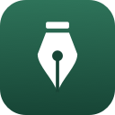
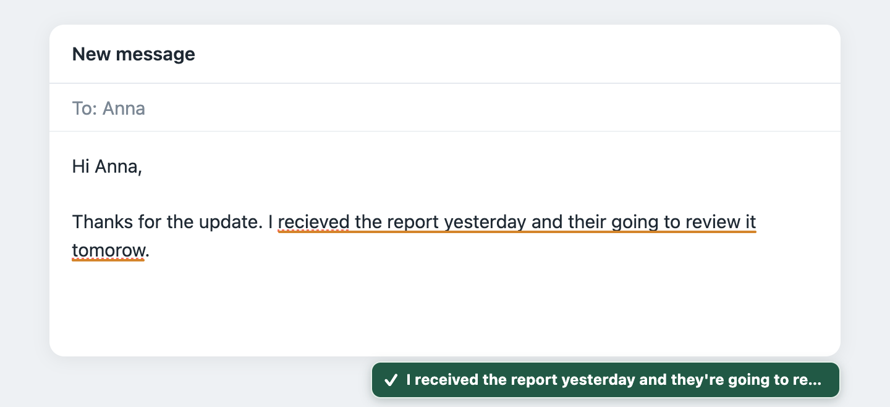
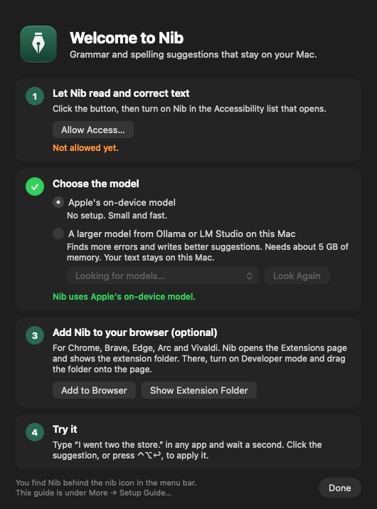
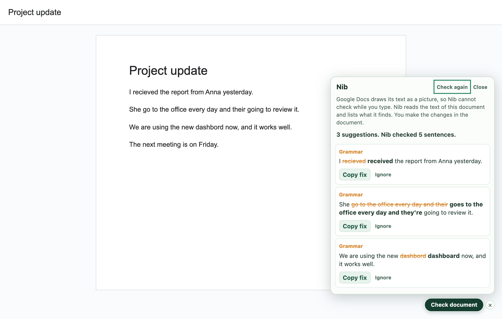

# Nib

**Private grammar and spelling suggestions for your Mac.** Nib checks what you type in most desktop apps and in Chromium browsers. Everything runs on your device. Nothing you write leaves your Mac.

Type, pause for a second, and Nib shows the fix. Click it, or press **⌃⌥↩**, and the text is corrected in place.

## Features

- **Private by design.** No account, no cloud, no telemetry. The checks run on your Mac.
- **Works where you write.** Mail, chat and notes apps on the Mac, and web pages in Chrome, Brave, Edge, Arc and Vivaldi.
- **Reads the sentence, not only the word.** An on-device model fixes errors that a spell checker cannot see: `their going to be late`, `I went two the store`.
- **Corrects, never rewrites.** A guard drops every answer that changes your meaning, your names or your numbers. `gonna` and `lol` stay as you wrote them.
- **Suggests improvements.** For a sentence without errors, Nib can offer a tighter version in your own words. A star marks it, so you can tell it from a correction.
- **Speaks your language.** Text in German, French, Spanish and other languages gets fixes in that language.
- **Checks Google Docs.** One click lists the fixes for a whole document.
- **More tools on the Mac.** Explain a fix, rewrite or translate a selection, read it aloud, snippets, a personal dictionary, and your own instructions per app.
- **Your choice of model.** Apple's on-device model needs no setup. A larger model from Ollama or LM Studio finds more.

## Install

You need an Apple silicon Mac with macOS 26 or later.

1. Get `Nib-<version>.dmg` from the [Releases](https://github.com/demirelo/nib/releases) page and open it.
2. Drag **Nib** to the **Applications** folder and open it.
3. macOS blocks the first launch, because Apple has not checked the app. Click **Done**, then follow the steps in the installer window: they open **Privacy & Security**, where you click **Open Anyway**.

A setup guide then takes you through the rest: the Accessibility permission, the choice of model, and the browser extension.

To build from source instead, see [CONTRIBUTING.md](CONTRIBUTING.md). In short: `bash Source/install.sh`.

### Browser extension

A browser does not let an app add an extension, so one step is yours.

1. In the setup guide, click **Add to Browser**. Nib opens the Extensions page of your browser and shows the folder **Nib Browser Extension** in Finder.
2. On the Extensions page, turn on **Developer mode**.
3. Drag the folder onto the page.

After an update of Nib, reload the extension on the Extensions page.

## Use

| Action | How |
|---|---|
| Apply the suggestion | Click it, or press **⌃⌥↩** |
| Dismiss the suggestion | Click **×**, or press **⌃⌥⌫** |
| Explain the suggestion | Press **⌃⌥E** |
| Proofread selected text | Press **⌃⌥P** |
| Rewrite or translate selected text | Press **⌃⌥R** |
| Open the selection in the Nib editor | Press **⌃⌥F** |
| Insert a snippet | Type `\name` and a space |

The Nib menu in the menu bar names the app in front and says what Nib sees there. Turn off **Check Text in This App** to pause Nib in one app.

Terminals, code editors, password managers and remote desktop tools are never checked. Password fields are never checked.

### Google Docs

Google Docs draws its text as a picture, so Nib cannot check there while you type. Click **Check document** at the lower right of a document. Nib reads the text and lists the fixes. You copy a fix and make the change in the document.

### A larger model

Apple's model is small. To find more errors and get better suggestions, install [Ollama](https://ollama.com), run `ollama pull qwen3`, and choose the model in **Settings… → Model**. Nib accepts a model server on this Mac only, so your text still stays on your device.

## Privacy

- Nib sends nothing to other machines. The optional model server must be on this Mac.
- Nib does not save your drafts. It saves your settings, your dictionary and your snippets.
- The extension can read the text fields on all sites. It checks them inside the page. With the Mac model on, it sends sentences to the Nib helper on the same Mac, and only after you type.
- For **Check document**, the extension asks Google Docs for the text of that document, with your own sign-in, and only when you click.
- The logs never hold your text. The browser log is off by default.

The full policy is in [PRIVACY.md](PRIVACY.md).

## Accuracy

`bash Source/test.sh --eval` scores Nib on labelled sentences. Results on one Mac, for 16 sentences with errors and 12 correct sentences that were not used to tune the rules:

| Mode | Exact fixes | False alarms |
|---|---|---|
| Without a model | 2 of 16 | 0 of 12 |
| Apple's model | 13 of 16 | 0 of 12 |
| `qwen3` through Ollama | 15 of 16 | 0 of 12 |

The sets are small, and model answers vary a little between runs. A correct sentence can still get a wrong suggestion. If you see one, please [report the sentence](https://github.com/demirelo/nib/issues).

## Limits

- Each app decides what it shows to Nib. Some apps get the suggestion button but no underlines.
- In Google Docs, Nib lists fixes on a click. It shows no underlines there. Google Sheets and Slides are not checked.
- Explain, rewrite, translate, snippets and autocomplete are in the Mac app only.
- The fixed grammar rules and the browser word list are English only. Other languages need the sentence model.
- The app is not notarized by Apple, so macOS blocks the first launch, and asks for the Accessibility permission again after each update.

## Troubleshooting

- **No suggestion shows.** Open the Nib menu. The line under the app name says why. In the browser, click the Nib icon in the toolbar: the popup says what Nib does on that page.
- **The permission is on, but Nib says it is missing.** Remove **Nib** from the Accessibility list, add `Nib.app` again with the plus button, and restart Nib.
- **A click on a suggestion changes nothing.** Select the text and press **⌃⌥P**.
- **No sentence fixes in the browser.** Choose **More → Connect Browsers…** in the Nib menu and reload the extension.

## Development

The Mac app is in `Source/` and the extension is in `Browser/`. [CONTRIBUTING.md](CONTRIBUTING.md) has the build and test commands, the rules and a file map. [SECURITY.md](SECURITY.md) says how to report a vulnerability. [CHANGELOG.md](CHANGELOG.md) lists the changes.

The pictures on this page show the real extension and app. The web pages in them are test pages.

## Credits and license

The browser spelling list is derived from Webster's Second International via the Berkeley `web2` distribution, with additional modern vocabulary. See [NOTICE.md](NOTICE.md).

Nib is released under the [MIT License](LICENSE).
